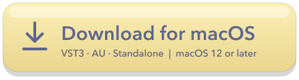
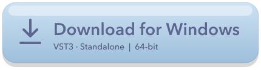
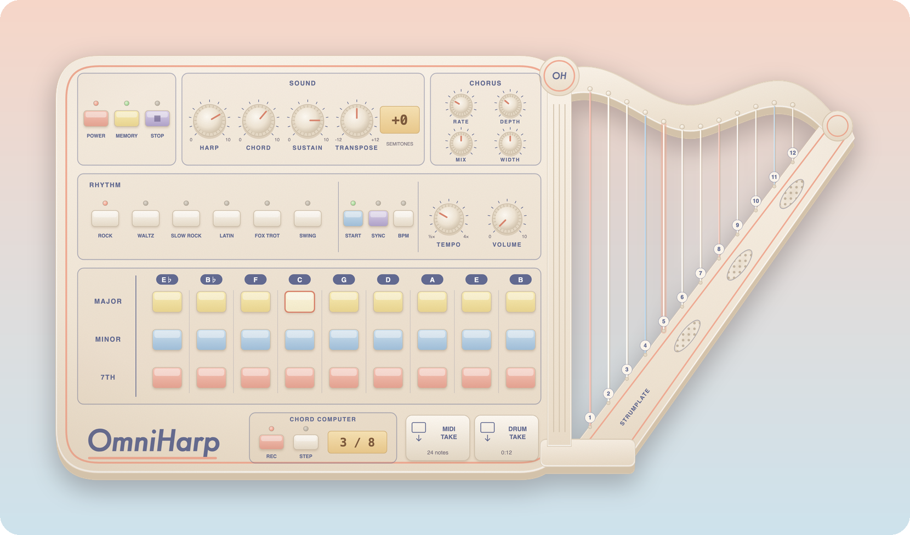
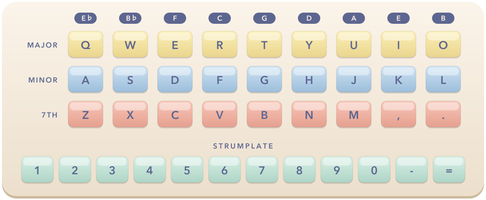

### Press a chord. Run a finger across the strings.
An Omnichord-inspired instrument for your DAW

   
  

 

## What's inside

<table>
<tr>
<td width="50%" valign="top">
  
**27 chords, and a few more** 
Major, minor and 7th in nine keys. Hold two buttons in a column for the OM-84's maj7, m7 and dim.

</td>
<td width="50%" valign="top">

**A harp that follows you** 
Twelve strings, always in the key of your chord. Click one, drag across them to strum, or play them over MIDI.

</td>
</tr>
<tr>
<td valign="top">

**Six rhythms** 
Rock, Waltz, Slow Rock, Latin, Fox Trot and Swing. Start them with your next chord, or lock them to your song's tempo with BPM.

</td>
<td valign="top">

**Layered chords** 
Hold up to four chords from different columns at once, and the strings play all of their notes.

</td>
</tr>
<tr>
<td valign="top">

**Chord Computer** 
Record a progression, then step through it one chord at a time with a single key. It's saved with your project.

</td>
<td valign="top">

**Wobbly tape, if you want it** 
Chorus and vibrato with Rate, Depth, Mix and Width, plus Sustain and a ±12 semitone Transpose.

</td>
</tr>
<tr>
<td colspan="2" valign="top">

**Drag your takes straight into the DAW** 
OmniHarp quietly records everything you play. Drag the MIDI TAKE tile onto a track for a MIDI clip, or DRUM TAKE for the rhythm as audio. Every take is also saved in `Music/OmniHarp Takes`.

</td>
</tr>
</table>

## Install

<b>macOS</b> 

 

1. Unzip the download.
2. Copy `OmniHarp.vst3` to `~/Library/Audio/Plug-Ins/VST3/`.
3. Copy `OmniHarp.component` to `~/Library/Audio/Plug-Ins/Components/` for Logic and GarageBand.
4. Rescan plugins in your DAW and find it under **Personal › OmniHarp**, on an instrument or MIDI track.

`OmniHarp.app` runs without a DAW. Drag it to Applications.

<b>Windows</b>

 

1. Unzip the download.
2. Copy the `OmniHarp.vst3` folder to `C:\Program Files\Common Files\VST3\`.
3. Rescan plugins in your DAW and find it under **Personal › OmniHarp**, on an instrument or MIDI track.

`OmniHarp.exe` runs without a DAW. The Windows build isn't code-signed, so SmartScreen may warn you: choose **More info › Run anyway**.

## Play it

In a DAW, your typing usually goes to the DAW instead of the plugin, so use the mouse or MIDI there. Click the **OH** crown on the harp for the full guide.

### MIDI

| Notes | Plays |
|:---|:---|
| 48–59 | Major chords, by root |
| 36–47 | Minor chords, by root |
| 24–35 | 7th chords, by root |
| 60–71 | Strumplate, string 1 to 12 |
| 72 | Chord Computer step |
| Channel 2, any note | Harp: the chord's closest note |
| Channel 10, 36–51 | 16 chord pads |
| CC 70–77 | Knobs |

Some DAWs, Ableton Live among them, send every note on channel 1, so the two channel-based rows won't work there.

## Good to know

- **Formats:** VST3 and Standalone on both systems, plus Audio Unit on macOS.
- **Local control port:** while running, OmniHarp listens on a port between 9890 and 9899, on your own computer only, for its optional MCP control.
- **Problems:** [open an issue](https://github.com/mard4/omniharp-releases/issues) with your system and DAW.
Runs on Apple Silicon and Intel Macs. <a href="https://github.com/mard4/omniharp-releases/releases">All releases</a>

## Credits

OmniHarp is an independent fan project, not affiliated with or endorsed by Suzuki. Built with [JUCE](https://juce.com/).
